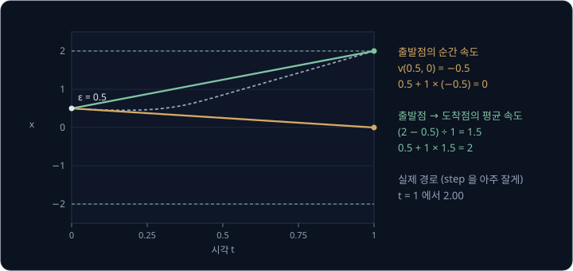
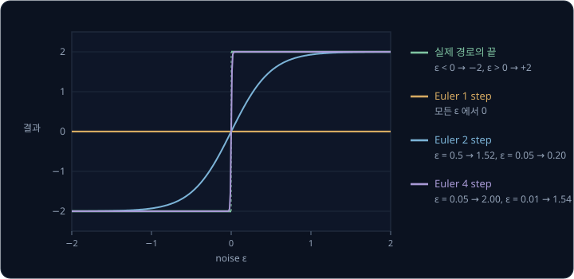
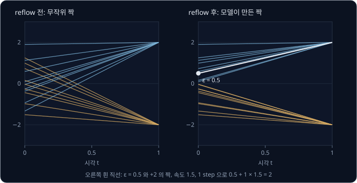
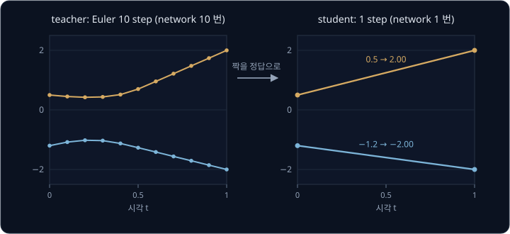
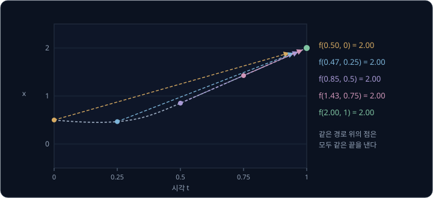
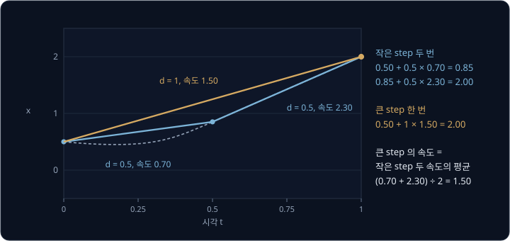
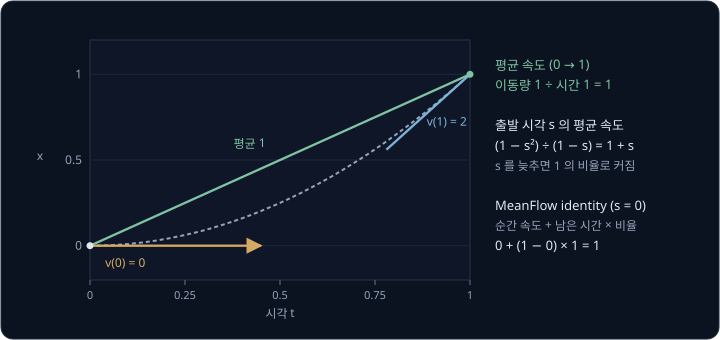

# One-step Flow

π0 는 action 50 개를 flow matching 의 Euler 10 step 으로 만드는데, RTX 4090 에서는 그 10 step 에 27 ms 가 걸린다. 로봇 옆에 두는 작은
GPU 에서는 같은 계산이 훨씬 오래 걸린다. GTX 1650 이 달린 노트북으로 저가형 로봇팔 SO-101 을 움직인 실험에서, 카메라 이미지와 지시문을
받아 action 을 내는 VLA(Vision-Language-Action) 모델 SmolVLA 는 앞으로 실행할 action 여러 개를 묶은 action chunk 하나를 만드는 데
228.2 ms 가 걸렸다. step 을 1 번으로 줄이면 시간도 줄겠지만, [Flow Matching](../flow-matching/README.md) 에서 본 것처럼 정답이
두 봉우리로 갈린 데이터에서 Euler 1 step 은 두 봉우리의 평균을 낸다. network 를 한 번만 쓰면서도 평균이 아닌 봉우리 하나에 닿게 할 수는
없을까?

이 강의에서 다루는 방법들은 network 가 지금 순간의 속도 대신 도착점까지 한 번에 건너뛸 평균 속도를 배우게 해서 이 문제를 푼다. 2026 년
Chen 등은 그중 하나인 MeanFlow 로 같은 SO-101 팔의 action 생성을 network 한 번으로 바꿔, 같은 노트북에서 action chunk 하나를 26.1 ms 에
만들었다.

## 학습 목표

- 순간 속도로 1 step 을 가면 휜 경로의 도착점에 닿지 못하고 평균 속도로 가면 닿는 이유를 설명할 수 있다
- reflow·distillation·consistency distillation 처럼 학습된 모델이 먼저 필요한 방법과, shortcut model·MeanFlow 처럼 처음부터 한 번에 학습하는
  방법이 정답을 만드는 법을 설명할 수 있다
- shortcut model 의 self-consistency 와 MeanFlow identity 를 숫자 예로 계산할 수 있다
- 로봇 policy 에서 one-step 이 줄이는 계산 시간과 성공률 변화를 보고 방법을 고르는 기준을 설명할 수 있다

## 순간 속도와 평균 속도

[Flow Matching](../flow-matching/README.md) 의 예처럼 데이터가 $+2$ 와 $-2$ 반반이고, network 가 그 강의에서 구한 marginal velocity field 를
정확히 낸다고 하자. noise $\epsilon = 0.5$ 에서 출발하면 $t = 0$ 에서는 두 데이터가 반반이라, 지금 자리를 지나는 쌍들의 데이터 평균
$\hat x_1$ 이 $0.5 \times 2 + 0.5 \times (-2) = 0$ 이다. 그래서 network 가 내는 속도는 아래와 같다.

$$
v(0.5,\ 0) = \frac{\hat x_1 - x}{1 - t} = \frac{0 - 0.5}{1 - 0} = -0.5
$$

Euler 1 step 은 이 속도로 시간 1 동안 직진하므로 $0.5 + 1 \times (-0.5) = 0$ 에 닿는다. 그런데 step 을 아주 잘게 나눠 같은 velocity field 를
따라가면 이 점은 처음에 조금 내려갔다가 다시 올라가 $t = 1$ 에 $+2$ 에 닿는다. 출발점의 속도는 출발한 순간의 방향일 뿐이고, 경로가 휘면
그 방향으로 끝까지 가서는 도착점에 닿지 못한다.

어느 한 순간의 속도를 **순간 속도**라 하고, 어떤 시간 동안 움직인 양을 그 시간으로 나눈 값을 **평균 속도**라 한다. 위 점의 $t = 0$ 부터
1 까지의 평균 속도는 이동량 $2 - 0.5 = 1.5$ 를 시간 1 로 나눈 1.5 다. 평균 속도에 걸린 시간을 곱하면 정의에 따라 이동량이 되므로, 경로가 아무리 휘어 있어도
평균 속도 1.5 로 한 번 직진하면 $0.5 + 1 \times 1.5 = 2$ 로 도착점에 정확히 닿는다.

| | 순간 속도로 1 step | 평균 속도로 1 step |
| --- | --- | --- |
| 쓰는 속도 | $t = 0$ 의 속도 $-0.5$ | $t = 0$ 부터 1 까지의 평균 1.5 |
| 도착 | $0.5 + 1 \times (-0.5) = 0$ | $0.5 + 1 \times 1.5 = 2$ |
| 맞는 경우 | 경로가 직선일 때만 | 언제나 |

flow matching 의 network 는 순간 속도를 배우므로 휘는 경로를 따라가려면 step 을 여러 번 밟아야 한다. 이 강의의 방법들은 모두 network 가
순간 속도 대신 한 번에 건너뛸 이동량(또는 그 평균 속도)을 배우게 해서 network 를 쓰는 횟수를 1 번까지 줄인다.

평균 속도는 출발 시각과 도착 시각을 모두 알아야 정해지는데, 위 점에서도 $t = 0$ 부터 0.5 까지의 평균 속도와 0.5 부터 1 까지의
평균 속도가 서로 다르다. 그래서 one-step 방법의 network 는 지금 위치와 시각 말고도 어디까지 건너뛸지(도착 시각이나 step 의 크기)를 입력으로 받거나,
도착 시각을 1 로 정해 두고 그 하나만 배운다.

> **오해** network 를 한 번만 쓰려면 경로가 완전한 직선이어야 한다.
>
> **사실** 평균 속도는 경로의 모양과 상관없이 출발점과 도착점만으로 정해지므로, network 가 평균 속도를 맞히면 휜 경로에서도 1 step 으로 도착점에 닿는다.

**확인 문제.** 위 데이터에서 $\epsilon = -1.2$ 에서 출발한 실제 경로는 $t = 1$ 에 $-2$ 에 닿는다. $t = 0$ 의 순간 속도로 1 step 을 가면
어디에 닿을까? 평균 속도는 얼마이고, 평균 속도로 1 step 을 가면 어디에 닿을까?

답 보기

① $t = 0$ 에서 $\hat x_1 = 0$ 이므로 순간 속도는 $(0 - (-1.2)) \div 1 = 1.2$ 이고, 1 step 이면 $-1.2 + 1 \times 1.2 = 0$ 에 닿는다.

② 평균 속도는 이동량 $-2 - (-1.2) = -0.8$ 을 시간 1 로 나눈 $-0.8$ 이다.

③ 평균 속도로 1 step 이면 $-1.2 + 1 \times (-0.8) = -2$ 에 닿는다.

답: 순간 속도로 가면 0 에 닿고, 평균 속도 $-0.8$ 로 가면 $-2$ 에 닿는다. 순간 속도로 가면 출발점이 어디든 $t = 0$ 에서 $\hat x_1 = 0$ 이라 언제나 0 에 닿는다.

## noise 와 결과의 짝

학습을 마친 flow matching 모델은 noise 를 하나 받으면 Euler step 을 잘게 밟아 결과 하나를 낸다. noise 와 결과의 짝을 모두 모으면
noise 를 결과로 보내는 함수 하나가 되고, one-step 모델은 network 한 번으로 이 함수의 값을 내야 한다.

$+2$, $-2$ 반반 데이터에서는 양수 noise 가 모두 $+2$ 로 가고 음수 noise 가 모두 $-2$ 로 가서, 이 함수의 값은 $\epsilon = 0$ 을 사이에 두고
$-2$ 에서 $+2$ 로 끊어져 뛴다. Euler step 을 적게 밟으면 이 뜀을 따라가지 못한다.

| noise $\epsilon$ | 실제 경로의 끝 | Euler 1 step | Euler 2 step | Euler 4 step |
| --- | --- | --- | --- | --- |
| 0.01 | 2.00 | 0 | 0.04 | 1.54 |
| 0.05 | 2.00 | 0 | 0.20 | 2.00 |
| 0.5 | 2.00 | 0 | 1.52 | 2.00 |
| 1.0 | 2.00 | 0 | 1.93 | 2.00 |

표의 값은 network 대신 정확한 marginal velocity field 로 계산했다. Euler 1 step 은 모든 noise 를 0 으로 보내고, step 을 늘릴수록
사이 값이 나오는 noise 의 범위가 0 근처로 좁아진다.

one-step 모델이 이 함수를 정확히 배우면 1 step 으로도 결과가 모두 $+2$ 나 $-2$ 로 나온다. 다만 network 의 출력은 입력을 조금 바꾸면 조금만
바뀌는 매끄러운 함수라서, 0 에서 수직으로 뛰는 모양을 완벽하게 만들기는 어렵다. 예를 들어 network 가 $\epsilon$ 이 $-0.05$ 와 $0.05$
사이일 때 $-2$ 에서 $+2$ 로 비스듬히 올라가는 함수를 배웠다면, 이 범위의 noise 는 두 봉우리 사이 값을 낸다. $\mathcal N(0, 1)$ 에서 뽑은
noise 가 이 범위에 들 확률을 계산하면 약 4% 다. 로봇이라면 상자의 왼쪽도 오른쪽도 아닌 정면으로 손을 뻗는 action 처럼
시연에 없던 두 길의 중간 action 이 100 번에 4 번쯤 나온다는 뜻이다.

**확인 문제.** network 가 $\epsilon$ 이 $-0.1$ 과 $0.1$ 사이일 때 결과를 $-2$ 에서 $+2$ 로 비스듬히 올리는 함수를 배웠다. $\mathcal N(0, 1)$
에서 뽑은 noise 가 이 범위에 들 확률이 약 8% 라면, sample 100 개 중 두 봉우리 사이 값은 몇 개쯤 나올까? 범위가 $\pm 0.05$ 일 때와 비교하면 어떻게 달라질까?

답 보기

① 범위가 $\pm 0.1$ 이면 $100 \times 0.08 = 8$ 개쯤 나온다.

② 범위가 $\pm 0.05$ 이면 확률이 약 4% 라서 $100 \times 0.04 = 4$ 개쯤 나온다.

답: 8 개쯤이고, 끊어지는 자리를 절반 폭으로 날카롭게 배우면 사이 값도 절반쯤으로 준다.

## reflow

noise 와 결과의 짝을 정답으로 쓰려면, 학습을 마친 모델로 짝을 만들어 그 짝을 잇는 직선으로 flow matching 을 한 번 더 학습하면
된다. Liu 등은 이 과정을 **reflow** 라고 불렀다. 논문 제목의 Rectified Flow 에 쓰인 rectify 는 곧게 편다는 뜻이다.

처음 학습에서는 noise 와 데이터를 무작위로 짝지었기 때문에 $+2$ 로 가는 직선과 $-2$ 로 가는 직선이 엇갈렸고, 엇갈리는 자리에서 network
가 두 정답 속도의 평균을 배워 경로가 휘었다. 학습을 마친 모델은 양수 noise 를 $+2$ 로 보내고 음수 noise 를 $-2$ 로 보내므로, 무작위 짝
대신 모델이 만든 짝 $(\epsilon, x_1')$ 으로 직선을 다시 그으면 엇갈리지 않는다. $\epsilon = 0.5$ 는 $+2$ 와 짝이 되어 target velocity 가
$2 - 0.5 = 1.5$ 다. 이 자리를 지나는 다른 직선이 없으니 network 는 1.5 를 그대로 배우고, 1 step 으로 $0.5 + 1 \times 1.5 = 2$ 에 닿는다.

reflow 한 모델이 배우는 1.5 는 앞 절에서 $\epsilon = 0.5$ 에서 출발한 점의 $t = 0$ 부터 1 까지의 평균 속도로 구한 값과 같다. 엇갈림이 없는 직선 위에서는 순간
속도와 평균 속도가 같기 때문이다.

이 1 차원 예는 reflow 한 번으로 엇갈림이 모두 사라지는 쉬운 경우다. 실제 데이터에서는 reflow 를 해도 경로가 완전한 직선이 되지 않지만,
경로가 곧아진 만큼 적은 step 으로 sampling 할 수 있다. Liu 등은 한 번 reflow 한 모델이 Euler step 한 번으로도 쓸 만한 이미지를 만든다고
보고했다.

reflow 는 학습이 두 단계다. 먼저 보통의 flow matching 모델을 끝까지 학습하고, 그 모델로 noise 마다 여러 step 의 sampling 을 해서 짝을
만든 뒤, 그 짝으로 다시 학습한다. 짝을 만드느라 sample 개수 × step 수만큼의 network 계산이 더 든다.

## distillation 과 consistency model

reflow 는 모델이 만든 짝으로 직선을 다시 그었지만, 짝의 결과를 network 의 출력으로 바로 맞히게 할 수도 있다. 여러 step 으로 결과를 만드는
학습된 모델을 **teacher** 라 하고, 그 결과를 network 한 번에 내도록 배우는 모델을 **student** 라 한다. teacher 의 출력을 정답으로
삼아 student 를 학습하는 방법은 **distillation** 이라 한다. distill 은 증류한다는 뜻이다.

$+2$, $-2$ 반반 데이터에서 teacher 가 Euler 10 step 으로 $\epsilon = 0.5$ 를 2.00 으로 보내고 $\epsilon = -1.2$ 를 $-2.00$ 으로 보냈다면, student 는
$(0.5,\ 2.00)$ 과 $(-1.2,\ -2.00)$ 을 입력과 정답의 짝으로 받아 자기 출력과 정답의 차이의 제곱을 줄인다. sample 하나를 만들 때
student 는 network 를 한 번 쓰고, teacher 는 10 번 쓴다.

짝을 정답으로 그대로 쓰면 student 가 배울 정답 하나를 만들 때마다 teacher 를 끝까지 계산해야 한다. Song 등이 2023 년에 발표한
**consistency model** 은 이 계산을 줄이려고 경로의 끝 대신 경로 위의 점들이 함께 지켜야 하는 성질을 정답으로 쓴다. consistency model 의 network $f(x_t, t)$ 는
경로 위의 어느 점을 받든 그 경로의 끝(데이터 쪽 결과)을 낸다. 같은 경로 위의 점은 끝이 같으므로 아래 조건이 성립해야 하는데, 이 조건을
self-consistency 라고 한다.

$$
f(x_t,\ t) = f(x_{t'},\ t') \qquad (x_t \text{ 와 } x_{t'} \text{ 이 같은 경로 위의 점일 때})
$$

$\epsilon = 0.5$ 에서 출발한 실제 경로 위의 네 점에 이 조건을 적용하면 아래 그림과 같다.

| 점의 시각 $t$ | 0 | 0.25 | 0.5 | 0.75 | 1 |
| --- | --- | --- | --- | --- | --- |
| 경로 위의 위치 $x_t$ | 0.50 | 0.47 | 0.85 | 1.43 | 2.00 |
| network 가 낼 값 $f(x_t, t)$ | 2.00 | 2.00 | 2.00 | 2.00 | 2.00 |

표의 위치는 정확한 velocity field 를 아주 잘게 따라가 계산한 값이다. 경로의 끝인 $t = 1$ 에서는 이미 데이터에 닿아 있으므로
$f(x_1, 1) = x_1$ 이 되어야 하는데, 이 조건을 boundary condition 이라 한다. Song 등은 network 출력을 입력 $x$ 와 섞는 출력 식을 써서, 학습과
상관없이 이 조건이 늘 지켜지게 했다.

학습할 때는 같은 경로 위의 가까운 두 점을 만들어 두 점의 출력이 같아지게 한다. 시각이 늦은 쪽 점은 끝에 더 가까워서 그 출력이
정답에 가까우므로, 이른 쪽 점의 출력을 늦은 쪽 점의 출력에 맞춘다. consistency model 의 학습은 두 점을 만드는 방법에 따라 아래 표처럼 나뉜다.

| | consistency distillation (CD) | consistency training (CT) |
| --- | --- | --- |
| 두 점을 만드는 법 | 한 점에서 teacher 로 solver step 한 번을 밟아 다음 점을 만든다 | 같은 데이터·같은 noise 를 두 시각으로 섞어 두 점을 만든다 |
| teacher | 필요하다 (학습이 두 단계) | 필요 없다 (처음부터 한 단계) |
| CIFAR-10 1 step FID | 3.55 | 8.70 |
| ImageNet 64×64 1 step FID | 6.20 | 13.0 |

CIFAR-10 은 10 종류의 물체를 찍은 32×32 크기의 작은 사진을 모은 dataset 이고, ImageNet 은 1000 종류의 물체 사진을 모은 dataset 이다.
FID(Fréchet Inception Distance)는 만든 이미지 묶음과 실제 이미지 묶음을 이미지 인식 network 에 넣어 나온 특징의 분포가 얼마나 다른지
잰 값이라, 작을수록 만든 이미지가 실제 이미지와 비슷하다. 표의 FID 는 Song 등의 논문 표 1·표 2 의 값이다. 같은 표에 따르면 teacher 인
diffusion 모델이 network 를 79 번 써서 ImageNet 64×64 이미지를 만들면 FID 가 2.44 라서, 1 step 의 품질은 teacher 보다 떨어진다. Song 등은
정답 쪽 출력을 내는 network 에 학습 중인 network 의 weight 를 천천히 따라가는 평균 weight(EMA, exponential moving average)를 써야 학습이 안정된다고 적었다.

consistency model 은 결과에 noise 를 다시 섞어 network 를 한 번 더 쓰는 방식으로 2 step 이나 그 이상으로도 sampling 할 수 있다.
CD 의 FID 는 CIFAR-10 에서 1 step 일 때 3.55 이고 2 step 일 때 2.93 이었다.

<b>심화: boundary condition 을 지키는 출력 식과 논문의 시각 방향</b>

Song 등은 diffusion 쪽 관례를 따라 데이터 쪽 끝을 작은 시각 $\varepsilon = 0.002$ 에 두고, noise 쪽 끝을 $T = 80$ 에 둔다. 이 강의와
시각의 방향이 반대라서, boundary condition 도 데이터 쪽 끝에서 $f(x_\varepsilon, \varepsilon) = x_\varepsilon$ 로 적는다.

network 를 $F_\theta$ 라 할 때 출력은 아래처럼 만든다.

$$
f_\theta(x, t) = c_{\text{skip}}(t)\,x + c_{\text{out}}(t)\,F_\theta(x, t), \qquad c_{\text{skip}}(\varepsilon) = 1,\quad c_{\text{out}}(\varepsilon) = 0
$$

데이터 쪽 끝에서는 두 계수가 1 과 0 이라 $F_\theta$ 가 무엇을 내든 출력이 입력 $x$ 그대로가 된다. Song 등은 논문 부록 C 에서
$c_{\text{skip}}(t) = \sigma_d^2 \div \big((t - \varepsilon)^2 + \sigma_d^2\big)$, $c_{\text{out}}(t) = \sigma_d\,(t - \varepsilon) \div \sqrt{\sigma_d^2 + t^2}$,
$\sigma_d = 0.5$ 를 썼다. $t = \varepsilon$ 을 넣으면 $c_{\text{skip}} = \sigma_d^2 \div \sigma_d^2 = 1$ 이고 $c_{\text{out}}$ 의 분자가 0 이다.

CT 는 데이터 $x$ 와 noise $z$ 를 하나씩 뽑아 두 점 $x + t_{n+1} z$ 와 $x + t_n z$ 를 만든다. 같은 $z$ 를 쓰므로 두 점은 한 데이터와 한
noise 를 잇는 경로 위에 있지만, 그 경로는 쌍 하나의 경로라서 학습된 모델이 실제로 따라가는 경로와 조금 다르다. Song 등은 두 시각의 간격이
작아질수록 CT 와 CD 의 loss 차이가 사라진다는 것을 보였다(정리 2).

**확인 문제.** consistency model 의 network 가 경로 위의 점 $(t = 0.5,\ x = 0.85)$ 에서 1.90 을 내고, 같은 경로 위의 점 $(t = 0.75,\ x = 1.43)$ 에서
1.98 을 낸다. 학습에서는 어느 쪽 출력을 어느 쪽 출력에 맞추고, 이 두 점의 loss 는 얼마인가? 차이의 제곱을 loss 로 쓴다.

답 보기

① 시각이 늦은 $t = 0.75$ 쪽이 경로의 끝에 더 가까우므로 그 출력 1.98 을 정답으로 둔다.

② 이른 쪽 출력 1.90 을 1.98 쪽으로 옮기도록 loss 를 $(1.98 - 1.90)^2 = 0.0064$ 로 구한다.

답: $t = 0.5$ 쪽 출력을 $t = 0.75$ 쪽 출력에 맞추고, loss 는 0.0064 다. 두 출력이 모두 경로의 끝인 2.00 이 되면 loss 가 0 이 된다.

## shortcut model

distillation 과 consistency distillation 은 teacher 를 먼저 학습해야 해서 학습 단계가 둘로 나뉜다. Frans 등이 2024 년에 발표한
**shortcut model** 은 teacher 없이 처음부터 한 번에 학습하고, network 하나로 step 수를 1 번부터 128 번까지 고를 수 있다.

shortcut model 의 network $s_\theta(x_t, t, d)$ 는 지금 위치와 시각에 더해 step 의 크기 $d$ 를 입력으로 받고, 그 크기로 한 번에 건너뛸
속도를 낸다. 다음 위치가 $x_t + d \times s_\theta(x_t, t, d)$ 이므로, 이 속도는 $t$ 부터 $t + d$ 까지의 평균 속도와 같은 뜻이다. $d$ 가 0 에
가까우면 건너뛰는 구간이 아주 짧아 평균 속도가 순간 속도와 같아지므로, $d = 0$ 에서는 보통의 flow matching 처럼 $x_1 - \epsilon$ 을 맞히게
학습한다.

큰 step 의 정답은 작은 step 두 번으로 만든다. 크기 $d$ 로 두 번 가는 것과 크기 $2d$ 로 한 번 가는 것이 같은 자리에 닿으려면, 큰 step 의
속도가 작은 두 step 속도의 평균이어야 한다. 이 조건을 shortcut model 의 self-consistency 라 한다.

$$
s(x_t,\ t,\ 2d) = \frac{s(x_t,\ t,\ d) + s(x'_{t + d},\ t + d,\ d)}{2}, \qquad x'_{t + d} = x_t + d \times s(x_t,\ t,\ d)
$$

$\epsilon = 0.5$ 에서 출발한 실제 경로에서 $d = 0.5$ 인 step 의 속도 두 개를 구하면 아래와 같다.

| 구간 | 출발 위치 | 도착 위치 | 속도 = 이동량 ÷ 0.5 |
| --- | --- | --- | --- |
| $t = 0$ → 0.5 | 0.50 | 0.85 | $(0.85 - 0.50) \div 0.5 = 0.70$ |
| $t = 0.5$ → 1 | 0.85 | 2.00 | $(2.00 - 0.85) \div 0.5 = 2.30$ |

두 속도의 평균 $(0.70 + 2.30) \div 2 = 1.50$ 이 $d = 1$ 로 한 번에 갈 때의 속도이고, 이 속도로 가면 $0.50 + 1 \times 1.50 = 2.00$ 으로
경로의 끝에 닿는다.

한 번의 학습 step 에 함께 쓰는 학습 데이터 묶음을 batch 라 한다. Frans 등은 shortcut model 의 batch 를 두 부분으로 나눠, 3/4 로는 $d = 0$ 의 flow matching 을 학습하고 1/4 로는 self-consistency 를 학습했다.
self-consistency 쪽은 $d$ 를 $1/128, 1/64, \ldots, 1/2$ 에서 골라 크기 $d$ 의 step 두 번을 network 로 계산하고, 그 평균을 크기 $2d$ 의
정답으로 쓴다. 가장 작은 $d = 1/128$ 의 두 step 은 flow matching 과 같은 $d = 0$ 을 넣어 계산하므로, 정답이 작은 step 에서 큰 step 으로 차례로 쌓여 올라간다.
작은 step 의 정답이 맞아야 큰 step 의 정답도 맞으므로, 학습 초기에 큰 step 의 정답은 부정확하다. 저자들은 정답을 만드는 network 에
weight 의 EMA 를 썼다. 저자들에 따르면 학습 계산은 같은 크기의 diffusion 학습보다 약 16% 늘었다.

Frans 등이 이미지 생성용 Transformer 인 DiT 의 기본 크기 network(DiT-B)를 방법마다 같은 계산량으로 ImageNet 256×256 에 학습했을 때 FID 는 아래와 같았다(논문 표 1).

| 방법 | 128 step | 4 step | 1 step |
| --- | --- | --- | --- |
| flow matching | 17.3 | 108.2 | 324.8 |
| reflow | 16.9 | 32.8 | 44.8 |
| consistency training | 42.8 | 43.0 | 69.7 |
| shortcut model | 15.5 | 28.3 | 40.3 |

flow matching 은 128 step 에서는 FID 가 낮지만 1 step 에서는 324.8 로 크게 나빠진다. shortcut model 은 한 network 로 세 경우 모두 다른 방법보다
낮은 FID 를 냈다. 다만 shortcut model 도 1 step 에서는 FID 가 40.3 으로 128 step 의 15.5 보다 나빠서, 저자들도 step 수에 따른 품질 차이가 남는다고 적었다.

<b>심화: 논문의 loss 식</b>

Frans 등의 시각 방향은 이 강의와 같아서 $x_0$ 은 noise 이고 $x_1$ 은 데이터이며, $x_t = (1 - t)\,x_0 + t\,x_1$ 이다. loss 는 두 항의 합이다.

$$
L = \big\lVert s_\theta(x_t, t, 0) - (x_1 - x_0) \big\rVert^2 + \big\lVert s_\theta(x_t, t, 2d) - s_{\text{target}} \big\rVert^2,
\qquad s_{\text{target}} = \frac{s_\theta(x_t, t, d) + s_\theta(x'_{t+d}, t + d, d)}{2}
$$

$s_{\text{target}}$ 은 정답으로만 쓰고 gradient 를 흘리지 않는다(stop-gradient). 둘째 step 은 데이터와 noise 를 섞은 점이 아니라 network 가
첫 step 으로 옮겨 놓은 $x'_{t+d}$ 에서 계산한다. 학습한 모델이 실제로 따라가는 경로 위의 점이어야 그 경로의 평균 속도가 정답이 되기 때문이다.
논문 본문의 loss 식은 둘째 항의 시각을 $t$ 로 적었지만, 같은 논문의 식 (4) 와 알고리즘 1 에서는 $t + d$ 로 적었다.

**확인 문제.** shortcut model 의 network 가 $d = 0.25$ 인 step 을 두 번 계산해 속도 1.2 와 1.8 을 냈다. $d = 0.5$ 의 정답 속도는 얼마이고, 출발 위치가 0.4 이면
$d = 0.5$ 한 번으로 어디에 닿을까? 작은 step 두 번으로는 어디에 닿을까?

답 보기

① $d = 0.5$ 의 정답 속도는 $(1.2 + 1.8) \div 2 = 1.5$ 다.

② 한 번에 가면 $0.4 + 0.5 \times 1.5 = 1.15$ 에 닿는다.

③ 작은 step 두 번으로 가면 $0.4 + 0.25 \times 1.2 = 0.7$ 을 거쳐 $0.7 + 0.25 \times 1.8 = 1.15$ 에 닿는다.

답: 정답 속도는 1.5 이고, 두 경우 모두 1.15 에 닿는다.

## MeanFlow

shortcut model 은 큰 step 의 정답을 작은 step 부터 한 단계씩 쌓아 올리므로, 1 step 의 정답이 맞으려면 그 아래 모든 크기의 step 이 먼저 맞아야
한다. Geng 등이 2025 년에 발표한 **MeanFlow** 는 이렇게 쌓아 올리지 않고 평균 속도의 정답을 바로 만든다.

MeanFlow 의 network 는 출발 시각 $s$ 의 위치 $x_s$ 와 출발 시각 $s$, 도착 시각 $e$ 를 받아 그 구간의 평균 속도 $u(x_s, s, e)$ 를 낸다.
출발 시각을 조금 늦추면 남은 구간이 짧아져 평균 속도가 바뀌는데, 순간 속도와 평균 속도 사이에는 아래 관계가 늘 성립한다. Geng 등은 이 식을
**MeanFlow identity** 라고 불렀다.

$$
u(x_s,\ s,\ e) = v(x_s,\ s) + (e - s) \times \frac{d}{ds}\,u(x_s,\ s,\ e)
$$

평균 속도는 지금의 순간 속도에 남은 시간 × (출발 시각을 늦출 때 평균 속도가 변하는 비율)을 더한 값이다. 출발을 늦추면 경로의
앞부분이 평균에서 빠지는데, 빠지는 부분의 속도가 지금의 순간 속도라서 두 속도가 이 식으로 묶인다.

[Flow Matching](../flow-matching/README.md) 의 Euler 법 절에서 본 점은 속도가 $v = 2t$ 로 커지는데, 이 점에 식을 적용해 확인한다. 이 점은 $x = t^2$ 을 따라가므로
출발 시각 $s$ 부터 도착 시각 1 까지의 평균 속도는 $(1 - s^2) \div (1 - s) = 1 + s$ 이고, 출발 시각을 늦출 때 평균 속도가 변하는 비율은 1 이다.

| 값 | 이 예의 값 ($s = 0$, $e = 1$) | 기호 |
| --- | --- | --- |
| 출발할 때의 순간 속도 | $2 \times 0 = 0$ | $v(x_s, s)$ |
| 남은 시간 | $1 - 0 = 1$ | $e - s$ |
| 평균 속도가 변하는 비율 | 1 | $\frac{d}{ds}\,u$ |
| 순간 속도 + 남은 시간 × 비율 | $0 + 1 \times 1 = 1$ | $u(x_s, s, e)$ |

평균 속도를 직접 계산하면 이동량 $1 - 0 = 1$ 을 시간 1 로 나눈 1 이라서 식의 결과와 같다.

학습에서는 이 식의 오른쪽을 정답으로 쓴다. 순간 속도 $v$ 자리에는 flow matching 과 같이 쌍 하나의 target velocity $x_1 - \epsilon$ 을
넣고, 비율 $\frac{d}{ds} u$ 는 학습 중인 network 자신의 출력을 미분해서 구한다. network 가 평균 속도를 잘못 내면 정답도 틀리지만, 학습이
진행되면서 network 의 출력과 정답이 함께 식을 만족하는 쪽으로 옮겨 간다. 정답은 gradient 를 흘리지 않는 상수로 쓴다(stop-gradient).

출발 시각과 도착 시각이 같으면 남은 시간이 0 이라 정답이 순간 속도 $x_1 - \epsilon$ 이 되어, 보통의 flow matching 과 같아진다. Geng 등은
batch 의 25% 만 두 시각을 다르게 뽑고 나머지 75% 는 같게 두었다. 1 step 으로 만든 ImageNet 256×256 이미지의 FID 는 두 시각을 다르게
뽑는 비율에 따라 아래와 같았다(논문 표 1).

| 두 시각이 다른 비율 | 0% (flow matching 과 같음) | 25% | 50% | 100% |
| --- | --- | --- | --- | --- |
| 1 step FID | 328.91 | 61.06 | 63.14 | 67.32 |

비율이 0% 면 보통의 flow matching 이라서 1 step FID 가 크게 나빠지고, 평균 속도를 조금이라도 배우면 크게 나아진다. 이 표는 작은 network(B/4)를
데이터 전체에 80 번 반복해(80 epoch) 학습한 실험이다. 논문 표 2 에 따르면 큰 network(XL/2, weight 6.76 억 개)를 240 epoch 학습했을 때는 1 step FID 가
3.43 이고 2 step FID 가 2.93 이었다. 같은 표에서 shortcut model 의 같은 크기 network 는 1 step FID 가 10.60 이고, 여러 step 을 쓰는 DiT-XL/2 는 network 를 250 × 2 번 써서 2.27 이었다.

비율 $\frac{d}{ds} u$ 를 구하려면 network 의 출력이 입력을 따라 얼마나 변하는지 계산해야 해서 학습 한 step 의 계산이 늘어난다. 논문의 측정에 따르면
학습 한 step 에 걸리는 시간은 flow matching 이 0.045 초이고 MeanFlow 가 0.052 초라서 약 16% 늘었다. teacher 는 필요 없다.

<b>심화: 출발 시각에 대한 비율의 계산과 논문의 시각 방향</b>

평균 속도 $u$ 는 위치 $x_s$ 와 출발 시각 $s$ 에 모두 달려 있다. 출발 시각을 $\Delta s$ 만큼 늦추면 점이 경로를 따라 $v \times \Delta s$ 만큼
움직이고 시각도 $\Delta s$ 만큼 늘어나므로, 평균 속도가 변하는 비율은 두 변화를 합한 값이다.

$$
\frac{d}{ds}\,u = v \times \frac{\partial u}{\partial x} + \frac{\partial u}{\partial s}
$$

$\frac{\partial u}{\partial x}$ 는 시각을 그대로 두고 위치만 바꿀 때 $u$ 가 변하는 비율이고, $\frac{\partial u}{\partial s}$ 는 위치를 그대로 두고
출발 시각만 바꿀 때의 비율이다. 이 합은 network 를 입력 방향 $(v,\ 1,\ 0)$ 으로 한 번 미분하는
Jacobian-vector product(JVP)로 구한다. 세 성분은 위치·출발 시각·도착 시각의 변화량이다. JVP 는 자동 미분 library 로 계산할 수 있고,
논문의 측정에서 학습 계산을 약 16% 늘렸다.

Geng 등은 diffusion 쪽 관례를 따라 데이터를 $t = 0$ 에 두고 noise 를 $t = 1$ 에 둔다. 그래서 $z_t = (1 - t)\,x + t\,\epsilon$ 이고, 순간 속도는
$v_t = \epsilon - x$ 로 적는다. network 의 입력 $z_t$ 는 noise 쪽인 늦은 시각 $t$ 에 있고 도착 시각 $r$ 은 그보다 이르다. 그래서 identity 를
$u = v - (t - r)\,\frac{d}{dt}u$ 로 적고 sampling 도 $z_r = z_t - (t - r)\,u$ 로 시간을 거슬러 간다. 1 step sampling 은
$x = \epsilon - u(\epsilon, 0, 1)$ 이다. 시각을 $1 - t$ 로 바꾸고 속도의 부호를 뒤집으면 이 강의의 식이 된다.

**확인 문제.** 속도가 $v = 2t$ 인 점(경로 $x = t^2$)에서 출발 시각 $s = 0.5$, 도착 시각 $e = 1$ 의 평균 속도를 직접 계산하고, MeanFlow identity
로도 계산해 같은지 확인하라. 출발 시각을 늦출 때 평균 속도 $1 + s$ 가 변하는 비율은 1 이다.

답 보기

① 직접 계산: 이동량은 $1^2 - 0.5^2 = 0.75$ 이고 시간은 $1 - 0.5 = 0.5$ 라서 평균 속도는 $0.75 \div 0.5 = 1.5$ 다.

② identity: 순간 속도는 $2 \times 0.5 = 1$ 이고 남은 시간은 0.5 이며 비율은 1 이라서 $1 + 0.5 \times 1 = 1.5$ 다.

답: 둘 다 1.5 다.

## 방법 비교

다섯 방법은 모두 network 가 한 번에 건너뛸 평균 속도나 도착점을 내게 하지만, 그 정답을 만드는 법이 서로 다르다.

| 방법 | 정답을 만드는 법 | 학습된 모델 | step 수 | 학습 계산 |
| --- | --- | --- | --- | --- |
| reflow | 학습된 모델이 만든 (noise, 결과) 짝의 직선 속도 | 필요 | 1 step 위주 | 짝마다 여러 step 의 sampling 이 더 든다 |
| distillation | teacher 가 여러 step 으로 만든 결과 | 필요 | 1 step | 정답마다 teacher 를 끝까지 계산한다 |
| consistency model | 같은 경로 위 이웃한 점의 출력 | CD 는 필요하고 CT 는 필요 없다 | 1 step 이나 noise 를 다시 섞은 여러 step | EMA network 를 함께 계산한다 |
| shortcut model | 작은 step 두 번의 평균 속도 | 필요 없다 | 1, 2, 4, …, 128 step 중 고른다 | diffusion 학습보다 약 16% 더 든다 |
| MeanFlow | MeanFlow identity 의 오른쪽 | 필요 없다 | 1 step 이나 2 step | flow matching 보다 약 16% 더 든다 |

학습된 모델이 필요한 세 방법은 먼저 보통의 flow matching 이나 diffusion 모델을 끝까지 학습해야 해서 학습이 두 단계다. 대신 이미 쓰고 있는 여러
step 모델이 있으면 그 모델을 출발점으로 쓸 수 있다. shortcut model 과 MeanFlow 는 처음부터 한 번에 학습하고, 학습 step 하나의
계산이 조금 늘어난다.

> **오해** one-step 방법은 모두 학습된 teacher 모델을 1 step 으로 줄이는 distillation 이다.
>
> **사실** shortcut model 과 MeanFlow, consistency training 은 teacher 없이 처음부터 한 번에 학습한다. teacher 가 필요한 것은 reflow, distillation, consistency distillation 이다.

## 로봇 policy 의 one-step

one-step 방법은 action 을 만드는 network 의 반복 횟수만 줄인다. 카메라 이미지와 지시문을 읽는 계산은 step 수와 상관없이 chunk 마다
한 번 하므로 그대로 남는다. Luan 등의 SnapFlow 는 π0.5 의 action 생성을 1 step 으로 줄였는데, A800 GPU 에서 chunk 하나의 계산 시간이 Euler
10 step 의 274 ms 에서 83 ms 로 줄었다. 274 ms 중 action expert 의 계산이 약 214 ms 였고, VLM 이 관측을 읽는 약 60 ms 는 1 step 이 되어도
남기 때문에 3.3 배만 빨라졌다.

Diffusion Policy 처럼 이미지 encoder 가 작은 policy 는 action 생성의 비중이 커서 더 많이 빨라진다. Prasad 등은
Diffusion Policy 를 teacher 로 삼아 consistency distillation 으로 Consistency Policy 를 학습했고, 실물 로봇 실험에 쓴 노트북 GPU(RTX 3070 Ti)에서 계산 시간을 DDIM(DDPM 을 적은 step 으로 sampling 하는 계산)의 192 ms
에서 21 ms 로 줄였다. Chen 등의 one-step VLA 는 SmolVLA 와 같은 SmolVLM-2 를 VLM 으로 고정하고 action 생성 부분을 MeanFlow 로 처음부터 학습한 모델인데,
GTX 1650 노트북에서 계산 시간이 SmolVLA 의 228.2 ms 에서 26.1 ms 로 줄었다.

성공률은 과제에 따라 거의 그대로이거나 조금 떨어졌다. 아래 표의 Robomimic 은 로봇팔 조작 simulation benchmark 인데, 그중 Square 는 사각 너트를
기둥에 끼우는 과제이고 ToolHang 은 도구를 걸이에 거는 과제다. Push-T 는 T 모양 블록을 밀어 목표 자리에 맞추는 과제이고, LIBERO 는
지시문을 따르는 로봇팔 조작 simulation benchmark 다.

| 논문 | 과제 | 여러 step | 1 step |
| --- | --- | --- | --- |
| Consistency Policy (표 I) | Robomimic Square | DDPM 100 step 0.93 | 0.92 |
| Consistency Policy (표 I) | Robomimic ToolHang | DDPM 100 step 0.79 | 0.70 |
| shortcut model (5.5 절) | Push-T | Diffusion Policy 100 step 0.95 | 0.87 |
| SnapFlow (표 1) | LIBERO 평균 | π0.5 Euler 10 step 97.75% | 98.75% |
| one-step VLA (표 V) | SO-101 세 과제 평균 | SmolVLA 84.5% | 78% |

Frans 등은 Diffusion Policy 를 그대로 1 step 으로 sampling 하면 Push-T 성공률이 0.12 로 떨어지는 것도 함께 보였다. one-step 으로 학습한
모델의 성공률은 0.87 이었으므로, 1 step 으로 쓰려면 그에 맞는 학습이 필요하다. 다만 이 손해는 과제마다 달라서, SnapFlow 의 표에서는 π0.5 를
아무 학습 없이 Euler 1 step 으로 sampling 한 경우에도 LIBERO 성공률이 96.75% 였다. [Flow Matching](../flow-matching/README.md) 에서 본 것처럼
1 step 은 한 관측에 정답 봉우리가 여럿일 때 평균을 내서 틀리므로, 그런 장면이 적은 과제에서는 학습 없이 1 step 으로 써도 손해가 작다.

one-step 으로 바꿀 때 실제로 겪는 문제는 세 가지다.

- 봉우리를 고르는 능력이 약해질 수 있다. Prasad 등은 teacher 와 Consistency Policy 가 multimodal 행동을 일부 잃어 Push-T 에서 한쪽으로
  치우치는 경향을 보였다고 적었지만, 이를 수치로 재지는 않았다. [noise 와 결과의 짝](#noise-와-결과의-짝) 에서 본 것처럼 끊어지는 자리 근처의
  noise 에서는 두 봉우리 사이 action 이 나올 수도 있다
- 정밀한 과제에서 손해가 크다. one-step VLA 의 SO-101 실험에서 쌓기 과제의 성공률은 SmolVLA 의 81.5% 에서 64% 로 떨어졌는데,
  저자들은 그 이유를 정밀도가 필요한 과제이기 때문이라고 적었다
- 학습 설정에 민감하다. 저자들이 학습 설정을 바꿔 본 실험(표 I)에서 batch 중 두 시각을 다르게 뽑는 비율을 0.2 로 두었을 때 성공률이 84.5% 였지만 1.0 으로 두었을 때는 4.5% 였고,
  loss 를 단순한 차이의 제곱으로 바꾸었을 때는 9.5% 였다

생성 방법만 바꿨을 때의 차이는 크지 않을 수도 있다. Yan 등은 ManiFlow 논문에서 같은 encoder 와 network 구조를 두고 생성 방법만 바꿔 비교했는데,
성공률은 ManiFlow 78.0%, DDIM 77.2%, shortcut model 76.2%, rectified flow 75.7% 로 차이가 2.3%p 안이었다(표 5). 성공률은 주로 생성 방법이 아닌
다른 부분에서 갈리므로, one-step 방법은 비슷한 성공률을 더 짧은 계산으로 내는 데 쓴다.

방법은 이미 가진 모델이 있는지와 계산 시간이 어디서 드는지를 보고 고른다.

| 상황 | 고르는 방법 | 예 |
| --- | --- | --- |
| 여러 step 으로 잘 되는 모델이 이미 있다 | 그 모델을 teacher 나 출발점으로 쓰는 distillation | Consistency Policy, SnapFlow(π0.5 에서 A800 한 장으로 약 12 시간) |
| 처음부터 학습하고 step 수를 상황마다 고르고 싶다 | shortcut model | 1 step 과 4 step 을 한 network 로 비교 |
| 처음부터 학습하고 1 step 품질이 가장 중요하다 | MeanFlow | one-step VLA |
| 계산 시간 대부분이 이미지·지시문을 읽는 데 든다 | one-step 효과가 작다 | 이미지 encoder·VLM 쪽을 먼저 줄인다 |

**확인 문제.** π0 의 추론 시간은 RTX 4090 에서 이미지 encoder 가 14 ms 이고, VLM 이 관측을 읽는 계산이 32 ms 이고, action expert 10 번이 27 ms
다. action expert 를 1 step 으로 줄이고 action expert 한 번에 걸리는 시간은 그대로라면, 전체 시간은 얼마이고 몇 배 빨라질까?

답 보기

① action expert 한 번은 $27 \div 10 = 2.7$ ms 다.

② 1 step 이면 전체는 $14 + 32 + 2.7 = 48.7$ ms 다.

③ 원래 전체는 $14 + 32 + 27 = 73$ ms 라서 $73 \div 48.7 \approx 1.5$ 배 빨라진다.

답: 전체 시간은 48.7 ms 이고, 약 1.5 배 빨라진다. action expert 의 계산을 10 배 줄여도 이미지와 지시문을 읽는 $14 + 32 = 46$ ms 가 남아 전체는 1.5 배만 빨라진다.

## 정리

- network 가 순간 속도를 배우면 휜 경로를 따라가는 데 여러 step 이 필요하지만, 한 구간의 평균 속도를 배우면 1 step 으로 도착점에 닿는다.
  $+2$, $-2$ 반반 데이터에서 noise 0.5 에서 출발해 순간 속도 $-0.5$ 로 1 step 을 가면 0 에 닿고, 평균 속도 1.5 로 가면 $+2$ 에 닿는다
- reflow·distillation·consistency distillation 은 학습된 모델이 만든 결과로 정답을 만들어서 학습이 두 단계다. shortcut model 은 작은 step
  두 번의 평균 속도로 정답을 만들고 MeanFlow 는 MeanFlow identity 로 정답을 만들어서, 둘 다 처음부터 한 번에 학습한다. ImageNet 256×256 의
  1 step FID 는 같은 크기의 network 에서 MeanFlow 가 3.43 이고 shortcut model 이 10.60 이었다
- 로봇 policy 에서 one-step 은 action 생성의 반복만 줄인다. 계산 시간은 π0.5 가 274 ms 에서 83 ms 로 3.3 배 줄었고, Diffusion Policy 가
  192 ms 에서 21 ms 로 줄었다. 성공률은 과제에 따라 거의 그대로였고, 정밀한 과제에서는 떨어졌다

이 강의에서는 action chunk 하나를 만드는 계산을 줄이는 방법을 다뤘다. 계산이 끝나기를 기다리는 동안에도 로봇이 멈추지 않도록 chunk 를 겹쳐 실행하는 방법과,
π0 가 VLM 의 계산을 저장해 두고 action expert 만 반복하는 구조는 [π0](../pi0/README.md) 에서 다룬다.

## 참고 자료

- Xingchao Liu, Chengyue Gong, Qiang Liu, [Flow Straight and Fast](https://arxiv.org/abs/2209.03003) (2022) — 모델이 만든 짝으로 다시
  학습하는 reflow 와, 한 번 reflow 한 모델의 1 step 이미지
- Yang Song 등, [Consistency Models](https://arxiv.org/abs/2303.01469) (2023) — self-consistency 와 boundary condition(3 절, 식 5),
  consistency distillation 과 consistency training(4·5 절), CIFAR-10·ImageNet 64×64 의 1·2 step FID(표 1·표 2)
- Kevin Frans, Danijar Hafner, Sergey Levine, Pieter Abbeel, [One Step Diffusion via Shortcut Models](https://arxiv.org/abs/2410.12557)
  (2024) — step 크기를 입력으로 받는 network 와 self-consistency(식 4, 3.1 절), 같은 계산량의 방법 비교(표 1), Push-T·Transport 의 1 step
  policy(5.5 절)
- Zhengyang Geng 등, [Mean Flows for One-step Generative Modeling](https://arxiv.org/abs/2505.13447) (2025) — 평균 속도의 정의와 MeanFlow
  identity(식 3·6), 두 시각을 다르게 뽑는 비율의 실험(표 1), ImageNet 256×256 의 1 step FID(표 2), JVP 의 계산 비용(부록 B.4)
- Aaditya Prasad 등, [Consistency Policy](https://arxiv.org/abs/2405.07503) (2024) — Diffusion Policy 를 teacher 로 쓴 consistency
  distillation, Robomimic 성공률(표 I)과 실물 로봇의 계산 시간(표 IV), multimodal 행동이 줄어드는 한계(5 절)
- Ge Yan 등, [ManiFlow](https://arxiv.org/abs/2509.01819) (2025) — consistency training 으로 학습한 manipulation policy 와, 같은 구조에서
  생성 방법만 바꾼 비교(표 5)
- Yang Chen, Xiaoguang Ma, Bin Zhao, [Mean-Flow based One-Step Vision-Language-Action](https://arxiv.org/abs/2603.01469) (2026) — SO-101
  팔에서 SmolVLA 와 비교한 계산 시간(그림 4)과 성공률(표 V), 학습 설정에 따른 성공률(표 I·표 II)
- Wuyang Luan 등, [SnapFlow](https://arxiv.org/abs/2604.05656) (2026) — π0.5·π0 의 self-distillation, LIBERO 성공률과 계산 시간(표 1),
  1 step 에서도 남는 VLM 계산 시간(부록 G)
